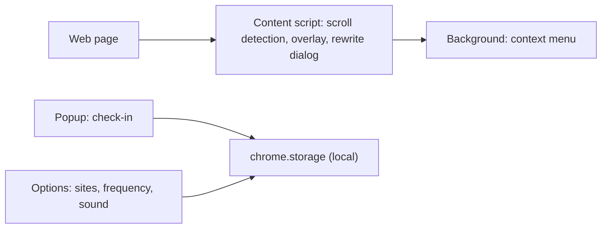

# Yasashii Ippun ("A Gentle Minute"): a calm-break browser extension

> Documentation only. The software is proprietary and its source is not published here.

**A small Chrome extension (Manifest V3) that offers a 60-second break guide and helps rephrase a blunt sentence into a gentler one, working locally in the browser.**

## What it does
- **Gentle scroll break:** after a set amount of scrolling on sites you choose, it offers a 60-second guide. Automatic prompts are **off by default** and work only on the sites you list.
- **Softer wording:** select text, right-click, get a gentler rewording. This is a deliberately **simple local rule set for Japanese text** (for example softening exclamation marks and blunt fillers), not an AI rewrite. The selected text stays in the browser.
- **One-tap check-in:** start a 60-second break from the toolbar popup and keep simple local statistics.

## How it is built
Plain HTML/CSS/JavaScript, no dependencies, Manifest V3. Site rules and statistics live in a small tested module.

## Status (honest version)
| Verified | How |
|---|---|
| Site rules (opt-in per site) and statistics | 2 automated tests pass |
| **Not verified** | |
| Behaviour in a real Chrome profile | not yet loaded and exercised end to end |
| Store readiness | icons, listing text and permission minimisation are still to do (the manifest currently asks for broad site access) |
| Optional account, generation and billing features | the popup can call an optional external service, only when the user configures it and presses a button. That service is unfinished and is **not** part of this project page |
| Interface language | Japanese |

## Feedback wanted
**Tell me what is unclear, missing or wrong**: use the [feedback form](https://github.com/johnknash2025/yasashii-ippun/issues/new?template=feedback.yml) or start a [discussion](https://github.com/johnknash2025/yasashii-ippun/discussions). Useful questions: Would you want this to work without any account? Which sites would you enable it on? Is a simple rule-based rewording useful, or would you want something smarter that still runs locally?

Please do not post confidential or personal data.

Contact: coming soon. Source code can be shared when we discuss a project.

© johnkhappy. All rights reserved.
